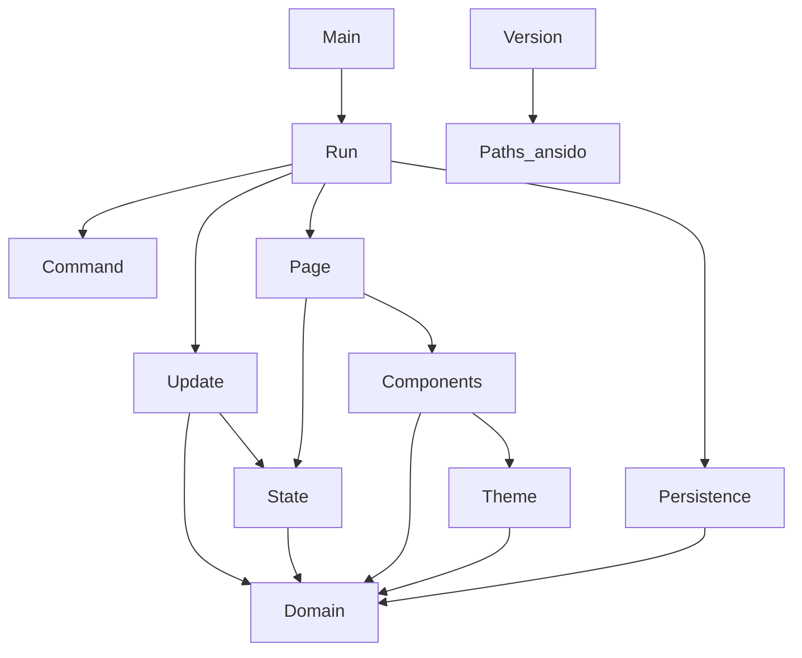

# Architecture

`ansido` is split into a pure core and a thin IO edge. The core owns every decision about tasks, categories, selection and rendering. The edge owns the terminal and the file system.

## Layers

| Layer | Modules | Responsibility |
| --- | --- | --- |
| Domain | `Ansido.Domain` | Immutable entities, smart constructors, queries, transitions and domain errors. |
| Persistence | `Ansido.Persistence` | Pure text format, file path resolution, loading and atomic saving. |
| Interface | `Ansido.Ui.Theme`, `Ansido.Ui.Components`, `Ansido.Ui.Page` | Shared theme, reusable components and pure pages built with Ansiform. |
| Application | `Ansido.App.State`, `Ansido.App.Update`, `Ansido.App.Command` | Application state, the data file path, pure update and key to command mapping. |
| Edge | `Ansido.App.Run`, `app/Main.hs` | Immediate input, line input, drawing, persistence calls and the loop. |
| Metadata | `Ansido.Version` | Version read from the Cabal package file. |

## Dependency direction

The arrows point toward the modules being used. No UI module writes files, and no domain module performs IO.

## Data flow

1. `readKeyEvent` returns a `Key`, decoding ANSI arrow sequences and the Enter, Backspace and Escape keys.
2. `commandForKey` turns the key and the current screen into a `Command`.
3. `execute` either handles the command directly, such as redraw, quit or open details, or starts a form with `readForm`.
4. `update` receives an `Action` and returns a new `AppState` or a `DomainError`.
5. `Ansido.App.Run` saves the workspace when it changed.
6. `renderPage` or `renderTaskForm` and `renderCategoryForm` build a new `Page`.
7. `Draw.draw` replaces the current page on screen.

The drawing state from Ansiform is threaded through the loop in `LoopState`. Every draw, redraw or replacement returns a new `Draw.State`, and that value is used by the next operation.

## Immutability

All bindings and fields are immutable. Transitions use record updates that produce new values. The `Workspace` constructor is hidden by the module export list, so the only way to build one outside `Ansido.Domain` is through `mkWorkspace` or the transitions. Lists are treated as persistent values; nothing is modified in place.

## Errors as data

The pure layers never throw. Domain failures use `DomainError`, persistence failures use `PersistenceError`, and both have English rendering functions. Exceptions are caught only at the file system boundary, where `try` converts `IOException` into `ReadFailed` or `WriteFailed`.

## Reusable components

The header, footer, category bar, notices, key hints and prompt lines live in `Ansido.Ui.Components`. Every screen uses the same `UiTheme`, so colors and spacing stay consistent. The task table, help table and category table are rendered with `printerTableBordered BordersNone` from Ansiform. The cells are padded to fixed widths before the table printer sees them, so alignment and truncation stay the same without a custom row renderer. `noticePrinter` returns a single notice line, so the board and category screens embed the notice in the same section as their table and keep the spacing exact.

## Ansiform notes

The project now uses Ansiform 1.0.0. It fits the application well: the split between pure builders and the drawing layer keeps pages testable, `Maybe Table` makes malformed tables explicit as data, and the `Theme` record and solid bars make the chrome consistent across screens.

The friction points found while building against 0.7.8.5 are resolved or clarified in 0.7.9.0 and later:

- The old synopsis for `printerSolidLineCenter` was ambiguous. The current documentation distinguishes `printerSolidLeft`, `printerSolidRight` and `printerSolidCenter`, which receive a `Block`, from `printerSolidLineLeft`, `printerSolidLineRight` and `printerSolidLineCenter`, which receive `[Block]`. The earlier note about a signature mismatch was a documentation issue, not an implementation change.
- `printerGroupsBordered` and its variants now pad unequal groups automatically, so a bordered group layout no longer needs manual `blockEmpty` padding.
- `readForm`, `Prompt`, `promptAt` and `FormError` handle multi-line page forms and the cursor arithmetic internally. The task and category prompts use `readForm`.
- The `readLineAt` documentation now warns that it already wraps `withLineInput`.
- `addNumber`, `subtractNumber` and `subtractNumberMaybe` make non-negative arithmetic explicit. The application does not subtract `Number` values, but checked subtraction is available when needed.
- Tables still truncate cells instead of wrapping them. The details screen uses `printerParagraph` to show the full note with word wrap, which is the right primitive for long text.
- Ansiform 0.7.10.3 gave `BordersNone` a true borderless table layout: every column stays on one row, with no border characters, no horizontal separators and no column bands. The application uses `printerTableBordered BordersNone` for the board, help and category tables. Cells are still padded to fixed widths with `textWidth` and `truncateVisible`, but the custom row renderer was removed.
- Ansiform 1.0.0 implements `promptWithInitial`, so the edit forms open their fields with the current values. See [Ansiform form initial values](ansiform-form-defaults.md).

The feedback is positive overall: the library provided the groups, tables, rules, solid bars and forms needed without pulling in a larger TUI framework.

## Selection model

`UiState` stores the selected screen, category, status filter and row; `AppState` also stores the data file path shown on the help screen. `clampAppState` restores the invariants after any change: the selected category must exist, and the row must point inside the filtered task list. On the category screen, `uiCategory` is both the highlight and the category acted on by `e` and `Del`; `MoveCategory` walks the category list and resets the row. The board renders a window of ten tasks, keeping the selected row visible and marking hidden rows with an ellipsis row. The details and edit screens resolve the selected task from `DetailsScreen TaskId` and `EditTaskScreen TaskId` instead of the row. The category edit screen resolves the category from `uiCategory`.

The filter is a `Filter` value with `ShowAll` and `OnlyStatus Status`. `visibleTasks` applies it, so the table, selection and clamping all use the same filtered list. Creating a task resets the filter to `ShowAll`; editing keeps the current filter.
