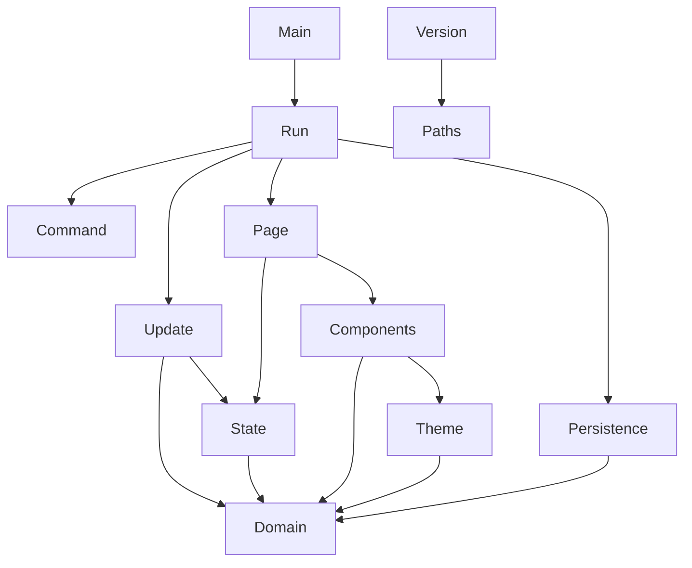

# Architecture

`ansido` is split into a pure core and a thin IO edge. The core owns every decision about tasks, categories, selection and rendering. The edge owns the terminal and the file system.

## Layers

| Layer | Modules | Responsibility |
| --- | --- | --- |
| Domain | `Ansido.Domain` | Immutable entities, smart constructors, queries, transitions and domain errors. |
| Persistence | `Ansido.Persistence` | Pure text format, file path resolution, loading and atomic saving. |
| Interface | `Ansido.Ui.Theme`, `Ansido.Ui.Components`, `Ansido.Ui.Page` | Shared theme, reusable components and pure pages built with Ansiform. |
| Application | `Ansido.App.State`, `Ansido.App.Update`, `Ansido.App.Command` | Application state, the data file path, pure update and key to command mapping. |
| Edge | `Ansido.App.Run`, `app/Main.hs` | Immediate input, line input, drawing, persistence calls and the loop. |
| Metadata | `Ansido.Version` | Version read from the Cabal package file. |

## Dependency direction

The arrows point toward the modules being used. No UI module writes files, and no domain module performs IO.

## Data flow

1. `readKeyEvent` returns a `Key`, decoding ANSI arrow sequences and the Enter, Backspace and Escape keys.
2. `commandForKey` turns the key and the current screen into a `Command`.
3. `execute` either handles the command directly, such as redraw, quit or open details, or starts line input.
4. `update` receives an `Action` and returns a new `AppState` or a `DomainError`.
5. `Ansido.App.Run` saves the workspace when it changed.
6. `renderPage` builds a new `Page`.
7. `Draw.draw` replaces the current page on screen.

The drawing state from Ansiform is threaded through the loop in `LoopState`. Every draw, redraw or replacement returns a new `Draw.State`, and that value is used by the next operation.

## Immutability

All bindings and fields are immutable. Transitions use record updates that produce new values. The `Workspace` constructor is hidden by the module export list, so the only way to build one outside `Ansido.Domain` is through `mkWorkspace` or the transitions. Lists are treated as persistent values; nothing is modified in place.

## Errors as data

The pure layers never throw. Domain failures use `DomainError`, persistence failures use `PersistenceError`, and both have English rendering functions. Exceptions are caught only at the file system boundary, where `try` converts `IOException` into `ReadFailed` or `WriteFailed`.

## Reusable components

The header, footer, category bar, notices, key hints and prompt lines live in `Ansido.Ui.Components`. Every screen uses the same `UiTheme`, so colors and spacing stay consistent. The task table, help table and category table are assembled from Ansiform tables rather than hand-formatted strings.

## Ansiform notes

Ansiform fits the application well. The split between pure builders and the drawing layer keeps pages testable, `Maybe Table` makes malformed tables explicit as data, and the `Theme` record and solid bars make the chrome consistent across screens.

Some friction points came up while building the interface:

- The Haddock synopsis for `printerSolidLineCenter` lists a `Block`, but the implementation takes `[Block]`. The compiler catches it, but the documentation mismatch costs a build cycle.
- `printerGroupsBordered` and the other bordered group printers expect every group to have the same number of blocks. Unequal groups produce misaligned borders. The earlier three-column board had to pad every column with empty blocks; the current task table avoids the problem by using `printerTableBordered`. Automatic padding or a named helper would still remove this trap for group-based layouts.
- `readLineAt` already wraps `withLineInput`. The documentation says it reads a line with echo, but does not warn that wrapping it again breaks the terminal mode.
- Tables truncate cells instead of wrapping them. The details screen uses `printerParagraph` to show the full note with word wrap, which is the right primitive for long text.
- Multi-line prompts rely on exact line counts. A higher-level helper that takes a page plus a list of prompts and handles the cursor arithmetic would make forms less fragile.
- The `Number` newtype is convenient, but its `Num` instance lets arithmetic read like plain integers, so code that subtracts needs care to keep the non-negative invariant obvious.

The feedback is positive overall: the library provided the groups, tables, rules, solid bars and input primitives needed without pulling in a larger TUI framework.

## Selection model

`UiState` stores the selected screen, category and row; `AppState` also stores the data file path shown on the help screen. `clampAppState` restores the invariants after any change: the selected category must exist, and the row must point inside the task list. The board renders a window of ten tasks, keeping the selected row visible and marking hidden rows with an ellipsis row. The details screen resolves the selected task from `DetailsScreen TaskId` instead of the row.
