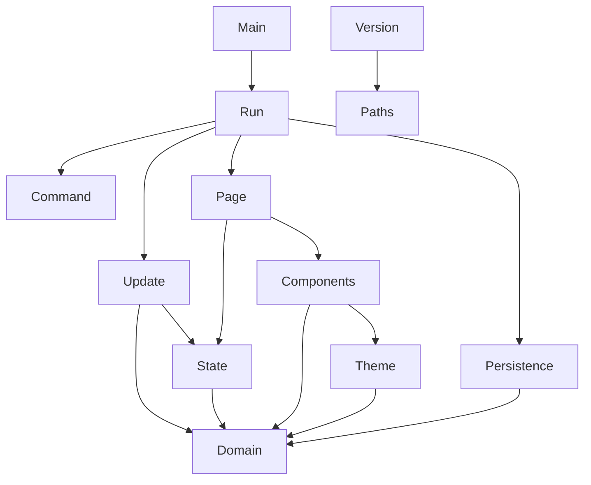

# Architecture

`ansido` is split into a pure core and a thin IO edge. The core owns every decision about tasks, categories, selection and rendering. The edge owns the terminal and the file system.

## Layers

| Layer | Modules | Responsibility |
| --- | --- | --- |
| Domain | `Ansido.Domain` | Immutable entities, smart constructors, queries, transitions and domain errors. |
| Persistence | `Ansido.Persistence` | Pure text format, file path resolution, loading and atomic saving. |
| Interface | `Ansido.Ui.Theme`, `Ansido.Ui.Components`, `Ansido.Ui.Page` | Shared theme, reusable components and pure pages built with Ansiform. |
| Application | `Ansido.App.State`, `Ansido.App.Update`, `Ansido.App.Command` | Application state, pure update and key to command mapping. |
| Edge | `Ansido.App.Run`, `app/Main.hs` | Immediate input, line input, drawing, persistence calls and the loop. |
| Metadata | `Ansido.Version` | Version read from the Cabal package file. |

## Dependency direction

The arrows point toward the modules being used. No UI module writes files, and no domain module performs IO.

## Data flow

1. `readKey` returns a `Char`.
2. `commandForKey` turns the key and the current screen into a `Command`.
3. `execute` either handles the command directly, such as redraw or quit, or starts line input.
4. `update` receives an `Action` and returns a new `AppState` or a `DomainError`.
5. `Ansido.App.Run` saves the workspace when it changed.
6. `renderPage` builds a new `Page`.
7. `Draw.draw` replaces the current page on screen.

The drawing state from Ansiform is threaded through the loop in `LoopState`. Every draw, redraw or replacement returns a new `Draw.State`, and that value is used by the next operation.

## Immutability

All bindings and fields are immutable. Transitions use record updates that produce new values. The `Workspace` constructor is hidden by the module export list, so the only way to build one outside `Ansido.Domain` is through `mkWorkspace` or the transitions. Lists are treated as persistent values; nothing is modified in place.

## Errors as data

The pure layers never throw. Domain failures use `DomainError`, persistence failures use `PersistenceError`, and both have English rendering functions. Exceptions are caught only at the file system boundary, where `try` converts `IOException` into `ReadFailed` or `WriteFailed`.

## Reusable components

The header, footer, category bar, notices, truncation, status blocks and prompt line live in `Ansido.Ui.Components`. Every screen uses the same `UiTheme`, so colors and spacing stay consistent. The board, help table and category table are assembled from Ansiform groups and tables rather than hand-formatted strings.

## Selection model

`UiState` stores the selected screen, category, status column and row. `clampAppState` restores the invariants after any change: the selected category must exist, and the row must point inside the current column. The board renders a window of eight rows per column, keeping the selected row visible and marking hidden rows with an ellipsis.
